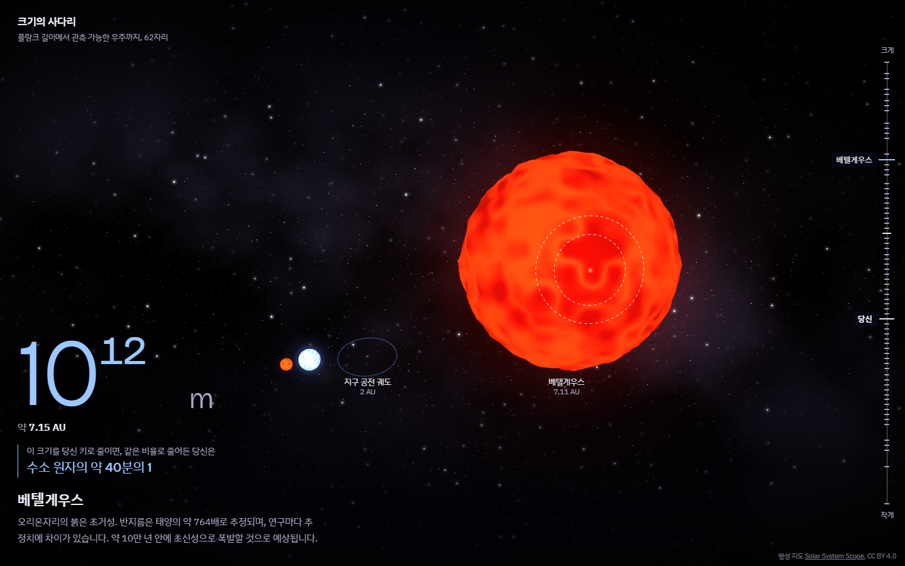
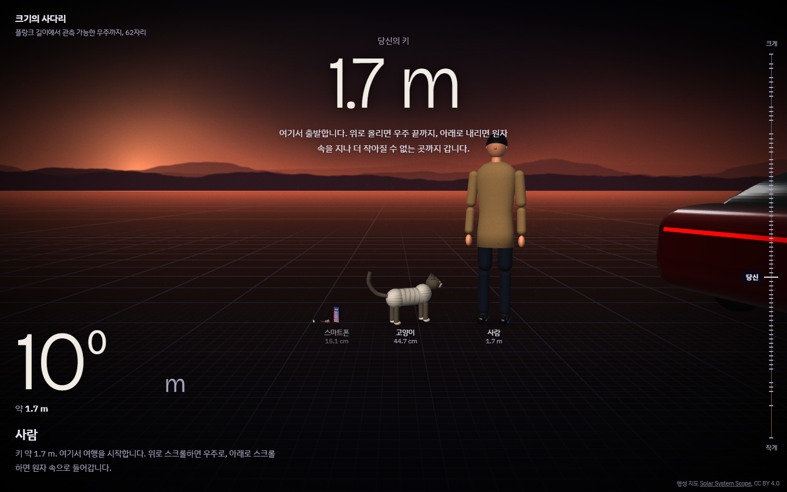
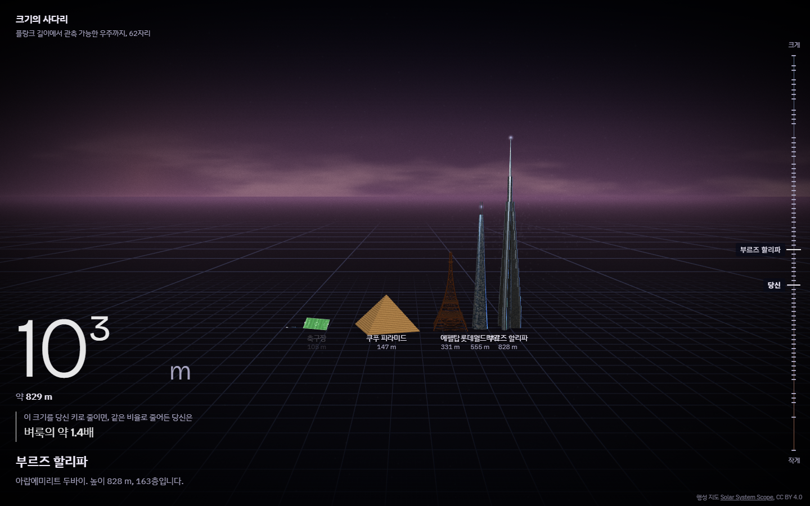
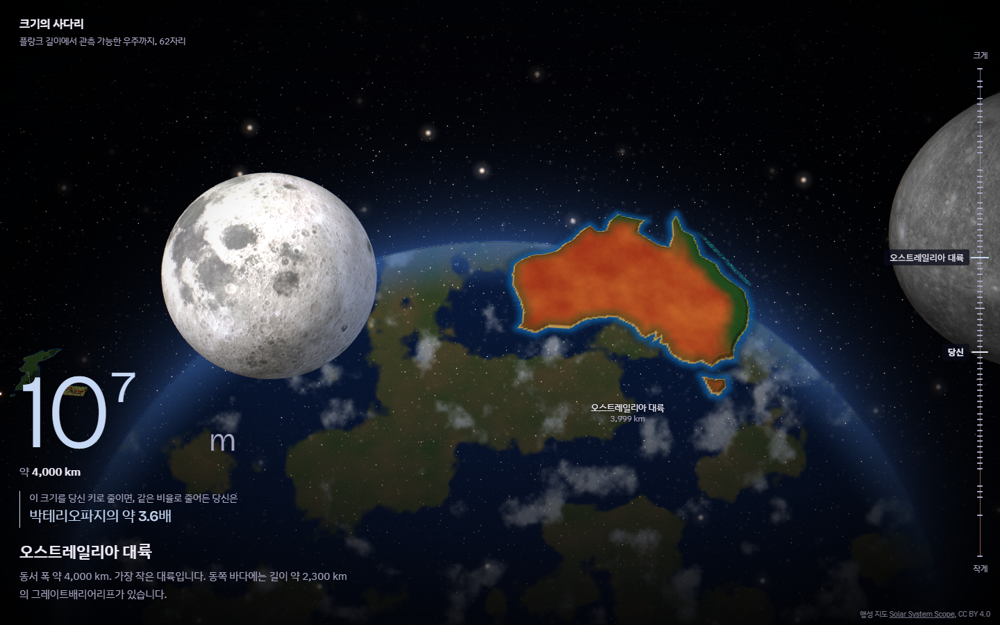
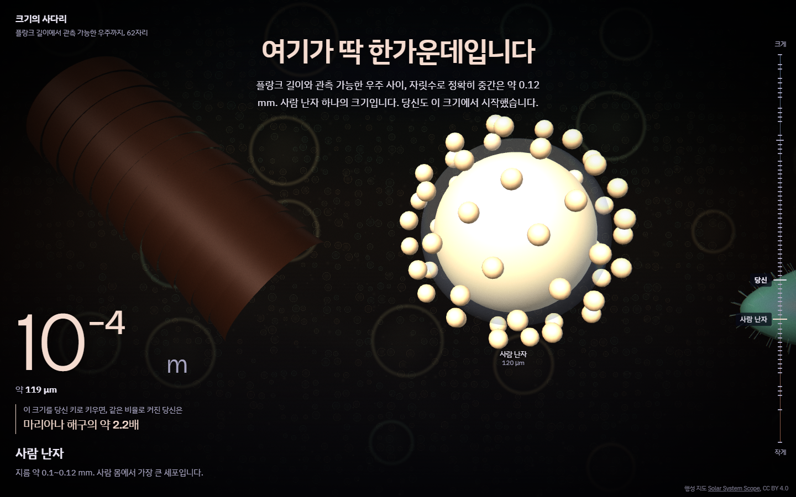
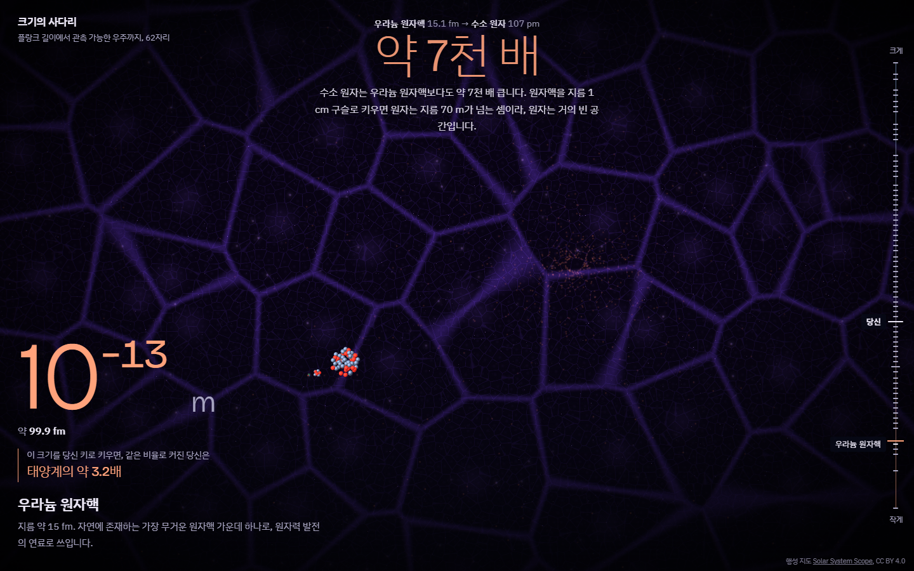

# 크기의 사다리: 미시에서 거시까지

플랑크 길이(10⁻³⁵ m)에서 관측 가능한 우주(10²⁷ m)까지, 62자리의 크기를 스크롤 하나로 오가는 3D 웹 경험입니다.
위로 스크롤하면 우주로, 아래로 스크롤하면 원자 속으로 들어갑니다.

목표는 정보 전달보다 **당혹감**입니다. 거시 세계와 미시 세계의 크기 차이가 얼마나 터무니없는지 몸으로 느끼게 하는 것입니다.



| | |
|---|---|
|  |  |
|  |  |
|  | |

## 무엇을 보여 주나

- **70여 개의 대상:** 쿼크, 원자, DNA, 적혈구, 쌀알, 고양이, 사람, 피라미드, 부르즈 할리파, 금문교, 에베레스트, 마리아나 해구, 그랜드 캐니언, 한반도, 오스트레일리아 대륙, 행성, 별, 성운, 은하, 초은하단, 관측 가능한 우주까지 모두 실제 크기 비율로 한 줄에 놓여 있습니다.
- **거울 문장:** 화면 왼쪽 아래에 "이 크기를 당신 키로 맞추면, 같은 비율로 변한 당신은 ○○"이 늘 표시됩니다. 원자를 사람 키로 키우면 사람은 지구 공전 궤도만 해지고, 플랑크 길이를 사람 키로 키우면 사람은 관측 가능한 우주의 약 2억 배가 됩니다.
- **가운데 큰 문장:** 크기의 충격을 짚어 주는 다섯 순간이 있습니다. 모든 숫자는 실제 값에서 계산했습니다.
  - 플랑크 길이와 우주 사이, 로그 눈금으로 딱 한가운데는 약 0.12 mm, 사람 난자 하나의 크기입니다.
  - 쿼크와 플랑크 길이 사이에는 알려진 구조가 하나도 없는 약 17자리의 공백이 있습니다.
  - 당신 몸의 원자 약 7×10²⁷개를 1초에 하나씩 세면, 우주 나이의 약 160억 배가 걸립니다.
- **끊김 없는 배경:** 셰이더 하나가 양자 거품, 분자 물결, 현미경 속 세포, 노을 하늘, 구름 바다, 둥글게 휘는 지구의 지평선, 별, 은하로 이어지며 규모와 함께 줌됩니다. 땅에는 10의 거듭제곱 간격 눈금이 규모에 맞춰 나타났다 사라집니다.
- **속도감:** 빨리 스크롤할수록 시야가 넓어지고 색이 번집니다.
- **접근성:** `prefers-reduced-motion`을 지원하고, 스크린리더에는 스크롤이 멈췄을 때 현재 대상을 한 번만 알립니다.

## 실행

Node.js 20 이상이 필요합니다.

```sh
npm install
npm run dev       # http://localhost:5173
npm run build     # 타입 검사 후 dist/에 빌드
npm run preview   # 빌드 결과 확인
```

`dist/`는 정적 파일이라 GitHub Pages, Netlify, Vercel 등 어디에나 올릴 수 있습니다(`vite.config.ts`의 `base: "./"`).

## 기술

- Vite, React 19, TypeScript
- three.js, React Three Fiber, @react-three/postprocessing (블룸, 색수차, 비네팅, 필름 그레인)
- 직접 쓴 GLSL: 별 표면(대류 무늬와 주연 감광), 배경 세계, 규모 눈금이 있는 땅
- 지형과 지도: 노이즈 기반 높이 필드, 경도·위도로 찍은 해안선

## 구조

```
src/
  App.tsx, Stage.tsx, Hud.tsx   화면 구성, 3D 캔버스와 후처리, HUD
  content.ts                    가운데 큰 문장
  engine/
    objects.js                  대상 목록 (이름, 크기, 설명, 이웃 비교)
    builders.js                 미시·우주 대상 모델
    earth.js                    지구 위 대상 모델 (사람, 탈것, 건축물, 지형, 지도)
    sky.js                      배경 셰이더와 땅
    world.js                    배치, 카메라, 매 프레임 갱신
    scroll.js                   스크롤과 규모의 변환
    mirror.js                   거울 문장 계산
public/tex/                     행성 텍스처
```

모든 것은 `e = log10(크기, m)` 하나로 움직입니다. 카메라는 거대한 좌표를 지나가지 않고, 대상마다 `10^(exp - e)`로 다시 스케일합니다. 자세한 설계는 [`CLAUDE.md`](CLAUDE.md)에 있습니다.

`main.html`은 React로 옮기기 전의 단일 파일 원본입니다. 브라우저에서 바로 열어 볼 수 있습니다.

## 정확도에 관해

- 크기와 비교 배수는 공개된 대표값을 기준으로 했습니다. 대상마다 "대표 크기"(지름, 키, 길이 중 하나)를 하나씩 골랐습니다.
- 모델은 알아보기 쉽게 단순화했습니다. 원자와 원자핵처럼 실제 비율로는 보이지 않는 것은 설명에 그렇다고 적었습니다.
- 그랜드 캐니언의 깊이는 과장했습니다.
- 한반도와 오스트레일리아의 해안선은 좌표를 직접 찍어 만든 근사치입니다.

## 출처

- 행성과 태양 텍스처: [Solar System Scope](https://www.solarsystemscope.com/textures/), CC BY 4.0
- 글꼴: Bricolage Grotesque, IBM Plex Sans KR (SIL Open Font License, `@fontsource`로 번들)
